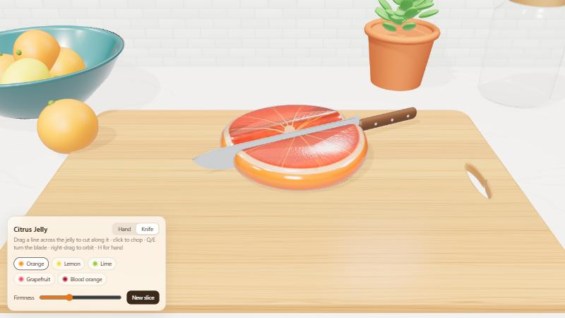
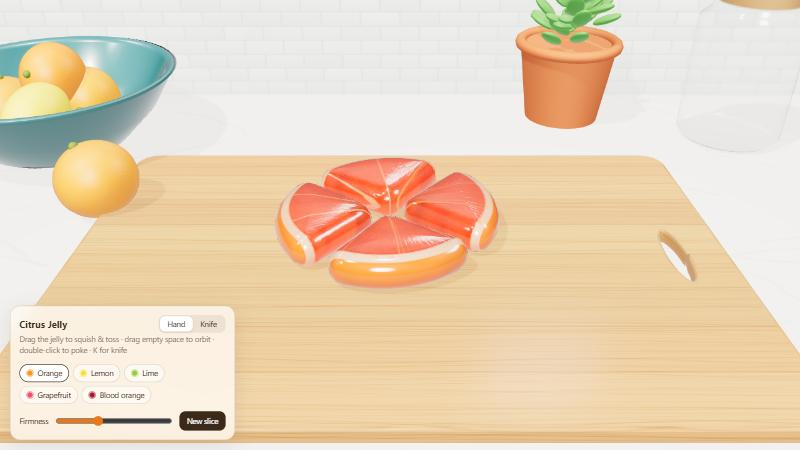

# Jelly Slice 🍊🔪

A squishy, translucent citrus-slice jelly you can poke, stretch, toss — and **cut into pieces with a knife** — on a kitchen cutting board. Runs in the browser, one HTML file, no build step.




**Live demo:** enable GitHub Pages (Settings → Pages → Deploy from branch → `main` / root) and open `https://maplerivertree.github.io/jelly_slice/`.

## Run it locally

It's a single file: [`index.html`](index.html). Three.js is loaded from a CDN, so you only need a browser with WebGL2.

```bash
python -m http.server 8000
```

Then open <http://localhost:8000>. (Double-clicking `index.html` usually works too, but some browsers are stricter about ES modules on `file://`.)

## Controls

| Tool | Action | What happens |
| --- | --- | --- |
| **Hand** (`H`) | drag the jelly | grabs a soft patch and pulls it — let go mid-drag to toss |
| | drag empty space | orbit the camera (scroll to zoom) |
| | double-click | poke a dent into the surface |
| **Knife** (`K`) | drag a line across the jelly | the knife aligns to your line and cuts along it |
| | click | chop at the knife's current angle |
| | `Q` / `E` | rotate the blade |
| | right-drag | orbit the camera |
| any | `R` / **New slice** | drop a fresh slice |
| any | fruit chips | orange, lemon, lime, grapefruit, blood orange |
| any | **Firmness** slider | gooey ↔ gummy |

## How it's built (short version)

- **Rendering** — Three.js `MeshPhysicalMaterial` with *transmission* (the cutting board refracts through the jelly), *attenuation* (thicker = deeper colour), clearcoat for the candy gloss. The citrus pattern, its translucency mask and bump are painted at runtime on `<canvas>`.
- **Shape** — every piece is a convex 2D outline, shrunk and then "inflated" by a sphere so all edges are rounded like a gummy.
- **Physics** — position-based dynamics with **overlapping-cluster shape matching**: dozens of small regions each try to return to their rest shape, which gives local wobble and squash while preserving volume. No physics library.
- **Collisions** — floor friction, the board's edges as walls, and piece-vs-piece contact using an exact distance function of a rounded slab.
- **Cutting** — the knife plane is mapped back into the slice's original (rest) space, the 2D outline is clipped into two convex halves, two new soft bodies are built, and each new particle inherits the position/velocity of its nearest old particle so the cut doesn't "pop".
- **Kitchen** — everything (wood grain, marble, tiles, fruit, bowl, jar, basil, towel) is generated in code from primitives and canvas textures. No image assets.

👉 **The full walkthrough — with the maths, diagrams and every tuning constant — is in [docs/HOW-IT-WORKS.md](docs/HOW-IT-WORKS.md).**

## Project layout

```
index.html              the whole app (≈1000 lines, sectioned with "// ----------" headers)
docs/HOW-IT-WORKS.md    detailed build notes
docs/images/            screenshots
LICENSE                 MIT
```

## Credits

- Inspired by the jelly experiments of [@vib3coded](https://x.com/vib3coded).
- Built on [three.js](https://threejs.org) (MIT).
- Physics techniques from Matthias Müller et al. — see the references at the end of [HOW-IT-WORKS](docs/HOW-IT-WORKS.md#references).

## License

[MIT](LICENSE)
