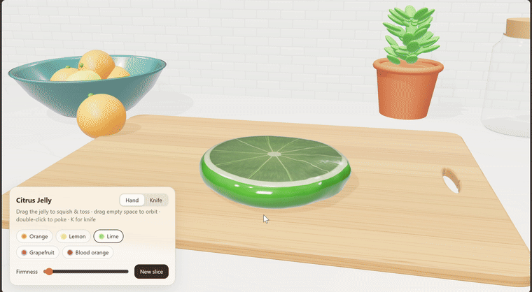
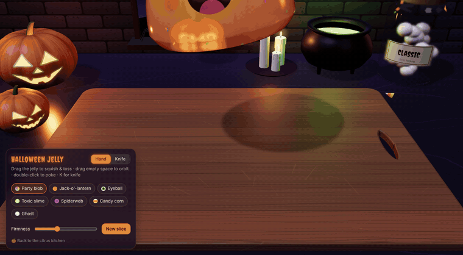

# Jelly Slice 🍊🔪

A squishy, translucent citrus-slice jelly you can poke, stretch, toss — and **cut into pieces with a knife** — on a kitchen cutting board. Runs in the browser, one HTML file, no build step.



<sub>Higher quality: [docs/media/demo.mp4](docs/media/demo.mp4)</sub>

**Live demo:** enable GitHub Pages (Settings → Pages → Deploy from branch → `main` / root) and open `https://maplerivertree.github.io/jelly_slice/`.

## 🎃 Halloween edition

A spooky second kitchen lives alongside the citrus one in [`halloween/index.html`](halloween/index.html). It uses the same squishy physics and the same knife, with a new kitchen and new jellies.



<sub>Higher quality: [docs/media/halloween.mp4](docs/media/halloween.mp4)</sub>

- **Seven flavours:** the **Party blob** drops by default. It's a grinning yellow 3D blob shaped like a fat water drop, wearing a party hat, and its glow cycles through the rainbow like the party-blob emoji. Slice it and each piece keeps its part of the dome. The others are Jack-o'-lantern (its carved face glows and flickers like a candle), Eyeball, Toxic slime, Spiderweb, Candy corn and Ghost. Each one is painted at runtime on `<canvas>`, with an extra *glow* layer that lights the jelly from inside.
- **A haunted kitchen:** moonlight through a window onto a graveyard, glowing jack-o'-lanterns (including a cute one on the window sill with **SMB** carved into it), dripping candles, a bubbling cauldron, a jar of gummy eyeballs, a dangling spider and a couple of bats. Like the citrus kitchen, everything is generated in code with no image assets.
- **Same controls** as the table below. With Pages enabled it lives at `https://maplerivertree.github.io/jelly_slice/halloween/`.

## Run it locally

It's a single file: [`index.html`](index.html). Three.js is loaded from a CDN, so you only need a browser with WebGL2.

```bash
python -m http.server 8000
```

Then open <http://localhost:8000>, or <http://localhost:8000/halloween/> for the Halloween edition. (Double-clicking `index.html` usually works too, but some browsers are stricter about ES modules on `file://`.)

## Controls

| Tool | Action | What happens |
| --- | --- | --- |
| **Hand** (`H`) | drag the jelly | grabs a soft patch and pulls it — let go mid-drag to toss |
| | drag empty space | orbit the camera (scroll to zoom) |
| | double-click | poke a dent into the surface |
| **Knife** (`K`) | drag a line across the jelly | the knife aligns to your line and cuts along it |
| | click | chop at the knife's current angle |
| | `Q` / `E` | rotate the blade |
| | right-drag | orbit the camera |
| any | `R` / **New slice** | drop a fresh slice |
| any | fruit chips | orange, lemon, lime, grapefruit, blood orange (Halloween: party blob + six spooky flavours) |
| any | **Firmness** slider | gooey ↔ gummy |

## How it's built (short version)

- **Rendering** — Three.js `MeshPhysicalMaterial` with *transmission* (the cutting board refracts through the jelly), *attenuation* (thicker = deeper colour), clearcoat for the candy gloss. The citrus pattern, its translucency mask and bump are painted at runtime on `<canvas>`.
- **Shape** — every piece is a convex 2D outline, shrunk and then "inflated" by a sphere so all edges are rounded like a gummy.
- **Physics** — position-based dynamics with **overlapping-cluster shape matching**: dozens of small regions each try to return to their rest shape, which gives local wobble and squash while preserving volume. No physics library.
- **Collisions** — floor friction, the board's edges as walls, and piece-vs-piece contact using an exact distance function of a rounded slab.
- **Cutting** — the knife plane is mapped back into the slice's original (rest) space, the 2D outline is clipped into two convex halves, two new soft bodies are built, and each new particle inherits the position/velocity of its nearest old particle so the cut doesn't "pop".
- **Kitchen** — everything (wood grain, marble, tiles, fruit, bowl, jar, basil, towel) is generated in code from primitives and canvas textures. No image assets.

👉 **The full walkthrough — with the maths, diagrams and every tuning constant — is in [docs/HOW-IT-WORKS.md](docs/HOW-IT-WORKS.md).**

## Project layout

```
index.html              the whole app (≈1000 lines, sectioned with "// ----------" headers)
halloween/index.html    the Halloween edition: same engine, haunted kitchen, seven flavours
docs/HOW-IT-WORKS.md    detailed build notes
docs/media/             demo GIFs + videos (citrus and Halloween)
LICENSE                 MIT
```

## Credits

- Inspired by the jelly experiments of [@vib3coded](https://x.com/vib3coded).
- Built on [three.js](https://threejs.org) (MIT).
- Physics techniques from Matthias Müller et al. — see the references at the end of [HOW-IT-WORKS](docs/HOW-IT-WORKS.md#references).

## License

[MIT](LICENSE)
